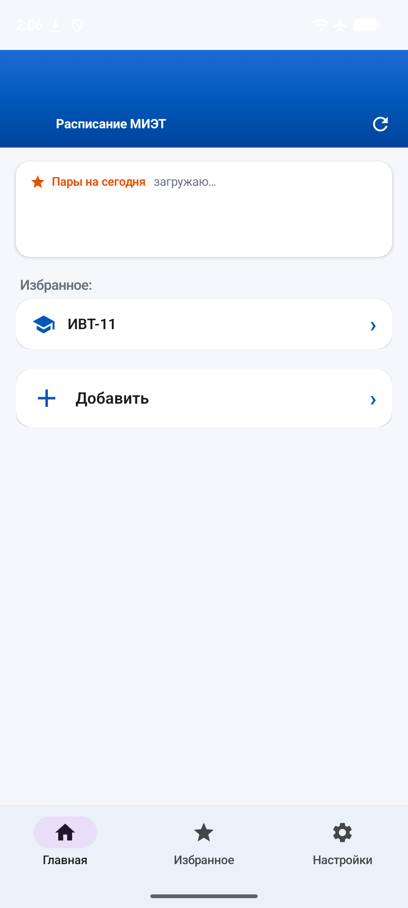
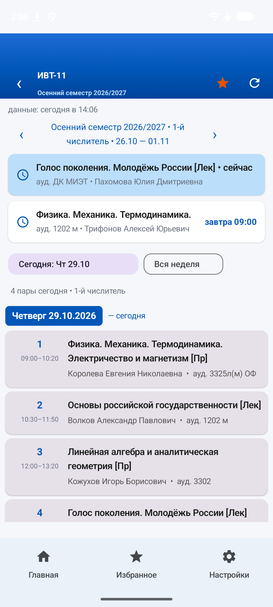
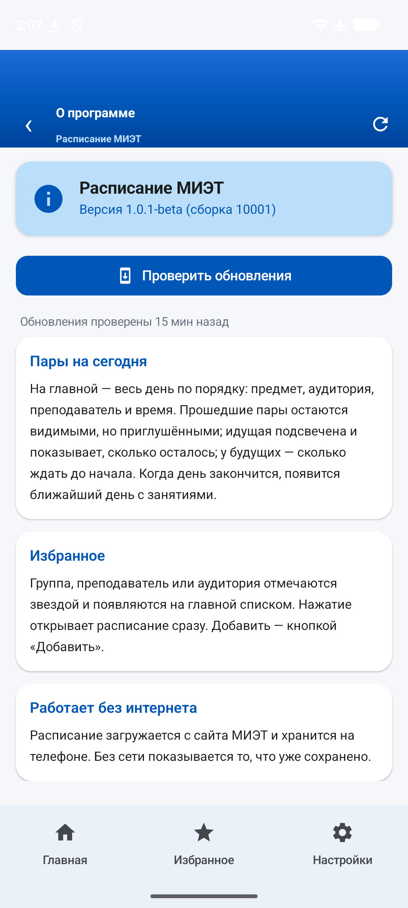

<table>
<tr>
<td width="62%" valign="top">

# Расписание МИЭТ

Приложение для Android: расписание занятий по группе, преподавателю или
аудитории. Показывает пары на сегодня, хранит расписание на телефоне и
напоминает о начале занятий.

<a href="../../releases/latest"></a>

<sub>· ~13 МБ · нужен Android 7.0+</sub>

**Как установить:**

1. Скачайте APK по кнопке выше.
2. Откройте скачанный файл.
3. Если Android спросит разрешение — разрешите установку из браузера: это
   стандартный вопрос для файлов не из магазина приложений.

</td>
<td width="38%" valign="middle" align="center">



</td>
</tr>
</table>

## Что умеет

- **Пары на сегодня** — весь день по порядку: предмет, аудитория, преподаватель,
  время. Прошедшие приглушены, идущая подсвечена, у будущих — отсчёт.
- **Расписание по группе, преподавателю или аудитории** — можно смотреть с любой
  стороны.
- **Избранное** — отметьте звёздами нужное, будет под рукой.
- **Напоминания** — за 1, 5, 10 или 15 минут до начала пары.
- **Работает без интернета** — расписание хранится на телефоне.
- **Тёмная тема** — и режим «как в системе».



## Чего в приложении нет

Ни рекламы, ни аналитики, ни сбора статистики. Наружу уходят только запросы
расписания к сайту МИЭТ; избранное, настройки и загруженное расписание лежат
на телефоне. Разрешения на геолокацию, контакты, камеру, микрофон и файлы не
запрашиваются.



## Сборка

Нужны JDK 17 и Android SDK (compileSdk 35, minSdk 24).

```bash
# путь к SDK — в local.properties (файл в .gitignore, в репозиторий не попадает)
echo 'sdk.dir=/путь/к/Android/Sdk' > local.properties

./gradlew assembleDebug     # отладочная сборка
./gradlew assembleRelease   # релизная сборка
./gradlew test              # модульные тесты
```

Готовый APK: `app/build/outputs/apk/release/app-release-unsigned.apk`.
Перед установкой его нужно подписать (`apksigner`) — ключ у каждого свой.

## Как устроено

| Файл | За что отвечает |
|---|---|
| `MietApi.kt` | запросы к сайту расписания МИЭТ |
| `ScheduleData.kt`, `Models.kt` | разбор ответа и модель данных |
| `MainActivity.kt` | навигация и состояние приложения |
| `HomeScreen.kt`, `ScheduleUi.kt` | главная и экран расписания |
| `PickersScreen.kt`, `GroupPickerUi.kt` | выбор группы, преподавателя, аудитории |
| `GroupPrefs.kt`, `HomePrefs.kt` | избранное и настройки главной |
| `ReminderScheduler.kt`, `BootReceiver.kt` | напоминания и их восстановление |
| `RefreshWorker.kt`, `CachePolicy.kt` | фоновая актуализация расписания |
| `UpdateChecker.kt`, `UpdateDialog.kt` | проверка новых версий через GitHub Releases |

## Обновления

Приложение само проверяет GitHub Releases: если вышел новый релиз, оно
предлагает скачать APK и ставит его через системный установщик, сверяя файл по
контрольной сумме из релиза. Поэтому в манифесте объявлено разрешение
`REQUEST_INSTALL_PACKAGES`.

Адрес репозитория задан одной константой — `UpdateChecker.REPO`. Если вы
собираете приложение из своего форка и раздаёте его сами, поменяйте её на свой
репозиторий. Тег релиза должен оканчиваться номером сборки (`1.0.1-beta.10001`):
без этого уже установленные версии обновление не увидят.

## Права на материалы

Приложение неофициальное: оно не является продуктом Национального
исследовательского университета МИЭТ и не связано с ним. Права на название
«МИЭТ», эмблему и данные о расписании занятий принадлежат правообладателю —
Национальному исследовательскому университету МИЭТ. Расписание берётся с
открытой страницы расписания университета и используется только для удобства
студентов и преподавателей, без претензий на эти материалы.

## Лицензия

MIT: код можно использовать, изменять, публиковать свои сборки — при условии,
что сохраняется текст лицензии (см. [LICENSE](LICENSE)). В файле лицензии
отдельно оговорено, что права на название «МИЭТ», эмблему и данные о расписании
остаются у правообладателя, а приложение неофициальное.
